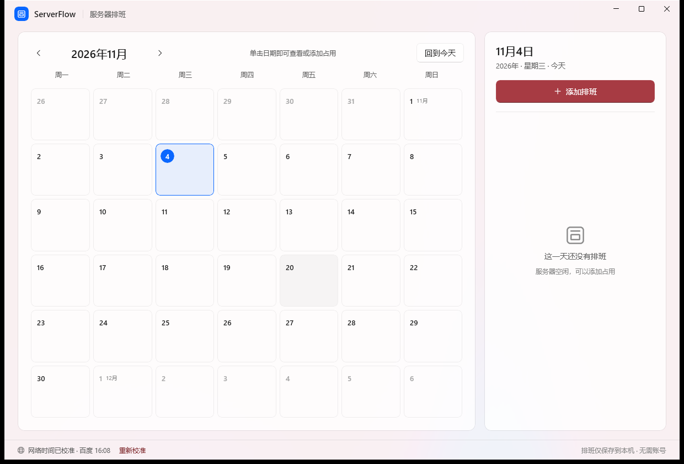

# ServerFlow 服务器排班


基于 **WinUI 3 / Windows App SDK / .NET 8** 的轻量服务器排班日历。Mica 半透明界面、Windows 原生控件风格，数据仅保存在本机。



## 功能

- 月历视图，单击日期查看当天占用。
- 单次、每天、每周重复；可设置开始时间、占用小时数和重复截止日期。
- 每个日期格带 24 小时纵向时间轴：占用按真实起止时间涂成色块，长排班跨天连续填充（50 小时 = 15h + 24h + 11h）。
- 添加排班时实时预览结束时间与跨越的日历日数。
- 前台操作 / 后台运行两种资源使用方式。
- 可选备注；无姓名、账号、登录或用户档案。
- 前台与后台互不冲突，可在同一时段并存并分两条泳道显示；同一使用方式之间仍阻止重叠，覆盖跨午夜、跨多日与长期周期。
- 本地 JSON 原子写入，断网可用。
- 网络仅用于：
  - 读取公开 HTTPS 响应的 `Date` 头校准时间；
  - 查询 GitHub Releases 最新版本。
- 不上传排班数据、不含遥测。

## 安装

下载 **[ServerFlow-Setup.exe](https://github.com/royluobox/ServerFlow/releases/latest/download/ServerFlow-Setup.exe)**，双击，在 UAC 窗口点“是”。

安装向导提供：

- 已安装检测：显示当前版本，按钮变为「覆盖安装」，并额外提供「卸载」。
- 安装位置信息（程序目录、排班数据路径，只读）。
- 「创建桌面快捷方式」「安装完成后立即启动」两个选项，默认都勾选。

覆盖安装保留排班数据；卸载会一并删除。

> **安装目录不可自定义**：本程序是 MSIX 应用，Windows 强制安装在 `C:\Program Files\WindowsApps\ServerFlow.Scheduler_<版本>_x64__pbhj1ej857fh2`，任何安装器都无法指定其他路径。如需换盘，可在「设置 → 系统 → 存储 → 应用安装位置」更改新应用的默认磁盘。排班数据存放在用户配置目录，与程序目录无关。
>
> 安装器使用项目自签名测试证书。仅在首次运行已签名 EXE 时 Windows 可能提示「未知发布者」；证书信任后不再提示。

其他下载项：`ServerFlow_<版本>_x64.msix`（证书已受信任时可直接双击安装）、`ServerFlow-Local.cer`、`Install-ServerFlow.cmd`。

不要双击 `ServerFlow.appinstaller`：它是自动更新源配置，不是安装入口，双击会报 `Error in parsing the app package`。
应用通过 `ServerFlow.appinstaller` 安装，以注册仓库 raw 文件中的更新源。

## 检查更新

- 底部“检查更新”按钮读取仓库 `main` 分支中 `tools/installer-template/ServerFlow.appinstaller` 的版本号，与当前程序集版本比较。
- **不使用 GitHub REST API**：匿名调用每 IP 每小时只有 60 次额度，会返回 `403 rate limit exceeded`。raw 文件不受限流影响，API 仅作后备渠道。
- 启动时自动检查一次；点「检查更新」会显示新版本，**点「立即更新」即自动下载并安装**，完成后应用自动重启，排班数据保留。
- 更新走 `.msix` 直装，同一发布者证书的升级不需要管理员权限，全程无 UAC；安装由独立进程执行，因此不会打断正在运行的窗口。
- 更新对话框可勾选「更新后重建桌面快捷方式」，重启后按新版本重绘快捷方式与图标。
- Windows 11 默认禁用 `ms-appinstaller:` 协议，因此不再依赖它做自动安装。
- 每个版本使用带版本号的 Release 资产地址，避免同名 CDN 缓存；发布新版时同步更新 raw 文件中的 `Version` 与 `MainPackage Uri`。raw 有约 5 分钟 CDN 缓存。

## 构建

要求：Windows 10 1809+，x64；.NET 8 SDK；NuGet 可访问。

```powershell
dotnet restore ServerScheduler/ServerScheduler.csproj -r win-x64
dotnet build ServerScheduler/ServerScheduler.csproj -c Release -r win-x64 -p:Platform=x64
dotnet run --project ServerScheduler.Tests/ServerScheduler.Tests.csproj -c Release
```

构建签名 MSIX 与 Release 资产：

```bash
bash tools/build_msix.sh
```

输出位于 `dist/ServerFlow-Installer/` 与 `dist/release/`。签名证书属于发布者私钥，**不在本仓库中**；`tools/signing/` 已被忽略。发布新版需准备 `ServerFlow-Local-Windows.pfx` 与同名 `.cer`。

## 发布

1. 更新 `Package.appxmanifest`、`.csproj` 和 `tools/installer-template/ServerFlow.appinstaller` 中的版本。
2. 运行 `tools/build_msix.sh`。
3. 将 `dist/release/` 中文件上传到 GitHub Release，标签格式 `v1.0.3`。
4. 更新 `tools/installer-template/ServerFlow.appinstaller` 中的 `MainPackage Uri` 为本次版本化 MSIX 资产地址，并推送到 `main`；App Installer 通过仓库 raw URL 读取更新源。

## 数据位置

```text
%LOCALAPPDATA%\Packages\ServerFlow.Scheduler_pbhj1ej857fh2\LocalCache\Local\ServerFlow\schedules.json
```

卸载应用前请备份该文件。

## 许可

[MIT](LICENSE)
